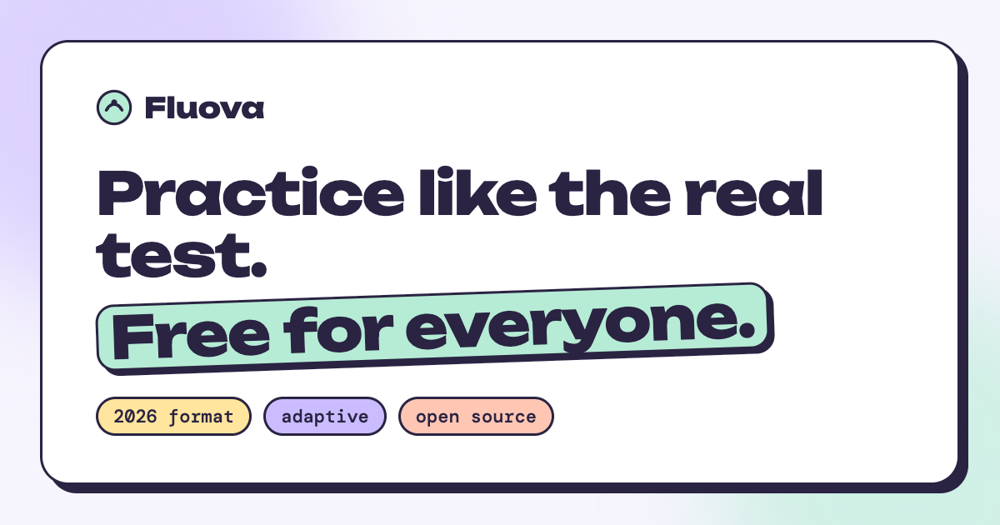

# Fluova

[](https://github.com/emrecpn/fluova/actions/workflows/quality-gate.yml)
[](https://github.com/emrecpn/fluova/actions/workflows/pages.yml)
[](LICENSE)
[](content/LICENSE.md)

**Free, open-source practice tests for the TOEFL iBT® test (January 2026 format).**

**▶ Try it: [emrecpn.github.io/fluova](https://emrecpn.github.io/fluova/)** · [Start a test](https://emrecpn.github.io/fluova/engine/) · [Add questions to the bank](CONTRIBUTING.md#question-bank)



Full-length tests with real timing, adaptive modules, and every task type from the 2026 specification. Everything runs in your browser: no account and no Fluova server, and your results are saved only on your device. (For Speaking transcripts you choose: the browser's own recognition, which Chrome and Edge run on their servers, or Whisper running on your device after a one-time ~250 MB download. See [docs/STT-RESULTS.md](docs/STT-RESULTS.md).)

> TOEFL® is a registered trademark of ETS. This product is not endorsed or approved by ETS.

## Why

Many paid practice tests feel easy and give inflated scores. The founder scored Reading ~5.5 on practice tests and **4.0** on the real test.

Fluova builds every test from the official 2026 blueprint. An automatic quality gate rejects any test that drifts from the real thing in either direction, too easy or too hard. Details are in [docs/FIDELITY-SPEC.md](docs/FIDELITY-SPEC.md).

## What's inside

| Section | Tasks |
|---|---|
| Reading | Complete the Words · Read in Daily Life · Read an Academic Passage (adaptive) |
| Listening | Listen and Choose a Response · Conversations · Announcements · Academic Talks (adaptive, US/UK/AU voices) |
| Writing | Build a Sentence · Write an Email · Academic Discussion |
| Speaking | Listen and Repeat · Take an Interview (recorded, transcribed by the browser's speech recognition) |

After each test you can copy two ready-made prompts and paste them into any AI chatbot, free ones included. One gets you feedback on your Writing and Speaking. The other turns your results into a personal study plan: it shows your accuracy by task and question type, lists every missed question with its explanation, and asks for targeted drills in the real format plus a day-by-day plan until your test date.

The interface and the answer explanations are available in English, Turkish and Spanish (Spanish still needs a native-speaker review). More languages are welcome. Test content is always in English.

## Run it locally

```bash
git clone https://github.com/emrecpn/fluova.git && cd fluova
npm run serve
```

Open <http://localhost:8000/engine/>. Use Chrome or Edge, because Listening uses the browser's speech synthesis and Speaking uses its speech recognition.

## Repository layout

```
engine/     the test player (static HTML/JS/CSS): js/scoring.js (scoring and routing), js/i18n.js (UI translations)
content/    question bank (content/bank), fixed-test recipes and rendered tests (content/tests), schema
generator/  form assembler, test builder page, prompt pack, Build a Sentence builder
tools/      bank.js, validate.js (structure), lint_forms.js (fidelity gate), e2e.js (browser smoke test), check_syntax.js, build_manifest.js, ctw_generate.js, layout_audit.js, stt-lab/
test/       unit tests (node:test): content pipeline, scoring and routing
fonts/      self-hosted fonts (OFL)
site/       landing page (multilingual static build)
docs/       fidelity spec, i18n architecture
```

## Quality gate and development

No dependencies: Node.js 22+ and Python 3 (for the local server) are enough.

```bash
npm run check   # syntax of every script, unit tests, question bank, random forms, validator, fidelity linter
npm test        # unit tests only (node:test)
npm run build   # rebuild bank.json, fixed tests, the manifest and the landing page
npm run e2e     # headless Chrome: page errors, CSP, layout in every language, resume, routing, a new test, Spanish review
npm run serve   # http://localhost:8000/engine/
```

The same checks run on every pull request, and a test with a critical finding cannot be merged. The browser smoke test (`tools/e2e.js`) has no dependencies either: it drives Chrome through the DevTools Protocol with Node's built-in WebSocket. Content is rendered as HTML, so only a few formatting tags are allowed (see [SECURITY.md](SECURITY.md)).

## Question bank

All content lives in a shared **question bank** (`content/bank/`), one small file per passage, conversation or task. Fixed tests are recipes of bank units, and **New test** on the start page assembles a fresh test in your browser from questions you have not seen yet. It uses no AI and no server, and the result still follows the 2026 blueprint and passes the quality gate. Today the bank holds four full tests' worth of questions (256 units). **Every unit you add makes every new test more varied: see [CONTRIBUTING.md](CONTRIBUTING.md#question-bank).**

## Making a new test

Open `generator/index.html` (the **test builder**). Copy a section prompt, paste the answer from any chatbot, and check it against the quality gate in your browser. You can also do the same from the command line:

```bash
node generator/assemble.js --id my-test-02 --title "Fluova Practice Test 2" reading.json listening.json writing.json speaking.json
```

Complete the Words blanks are always made by the C-test algorithm, and Build a Sentence items can be written in plain text (`generator/bas_build.js`). See [generator/README.md](generator/README.md).

## Contributing

Tests, translations, bug reports and code are all welcome. Start with [CONTRIBUTING.md](CONTRIBUTING.md).

## Support

Fluova is free and non-commercial. If it helped you, you can support the project with crypto. EVM address (Ethereum and EVM-compatible networks):

```
0x2C97C0EC81D2FE7887aefFaDe57196F6b9476d28
```

## License

- Code: [MIT](LICENSE)
- Test content (`content/`): [CC BY-SA 4.0](content/LICENSE.md)
